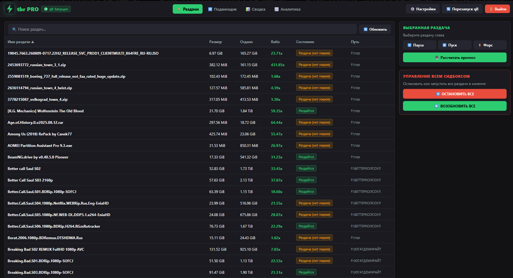

> [Читать на русском](README_RU.md)

# ⚡ tbr PRO — qBittorrent Swiss-Army Knife

> Core Version: **v3.0.1+** | Android Companion: **tbr-widget v1.3.0**  
> Integrated **EN / RU** localization toggle and custom themes right in the header!

# 🚀 Features & Arsenal

1. **Atomic .fastresume Stats Merger with Torrent Diff & Smart Match:**
   Ratio nerd's wet dream. Transfer `uploaded` & `seeding_time` metadata between torrents without corrupting bencode. Automatically shuts down and revives qBittorrent, inspects payload files via **Torrent Diff** (% volume match), auto-suggests matches via **Smart Match** (ignoring roman/arabic sequel numbering), and safely cleans up the source torrent with directory overlap safety (`content_path` inspection). Target goals auto-transfer seamlessly!

2. **Honest Like-for-Like (LFL) Analytics, Health Score & 365-Day Heatmap:**
   Zero phantom spikes from newly added torrents. "Today vs Yesterday" and "This Week vs Last" are calculated down to the exact second. Includes a GitHub-style 365-day upload heatmap, "Last Seeder" alert radar, swarm value metric (Health Score), and weighted historical ETA forecaster powered by 4 independent SQLite databases (WAL mode).

3. **Hardware & ISP Guard: Native Windows Anti-Sleep, Watchdog & ISP Detector:**
   Windows native sleep prevention via Win32 API (`SetThreadExecutionState`) keeps your rig awake when upload/download exceeds your threshold. qB Watchdog restarts unresponsive clients (up to 2 attempts with a 30s pause), Auto-Recheck tags dead drives with `io-error`, and the traffic inspector alerts you if your ISP is throttling your bandwidth.

4. **Disaster Recovery Manifest & Panic Killswitch:**
   Emergency red button for unexpected visitors or panic moments: instantly halts all torrents, locks global transfer limits to 1 B/s, freezes the autopilot for 1 hour, and optionally terminates the client process. Automated weekly Disaster Recovery manifests export your entire library, trackers, and magnet links to compact JSON.

5. **Orphan File Scanner:**
   Scans download roots for leftover files and abandoned folders that no longer belong to active torrents. Built with Path Traversal protection and double-confirmation safety (never deletes anything to recycle bin automatically).

6. **Smart Timers: Smart Freeze, Snooze & Expiration:**
   - **Smart Freeze:** Pauses only active torrents, memorizes them, and resumes exclusively what was running without unpausing long-forgotten torrents.
   - **Snooze Timer:** Background DB-backed sleep countdown (30m / 1h / 2h / custom) via speed throttling or freezing.
   - **Expiration Timer:** Self-destruct torrents based on age or upload volume (disk deletion is strictly opt-in).

7. **Zero-Trust Security & Private Vault:**
   Hashed passwords (`pbkdf2:sha256`) with auto-upgrade, standalone API tokens (`tbr_api_...`), single-use invite tokens (`/invite/<token>`), brute-force protection, and strict RBAC (Admin vs Viewer). The **Private Vault** filters out sensitive tags on the backend: torrents are either purged from guest views or anonymized in global sums without leaking titles.

8. **Next-Gen Automation & DND Quiet Hours (Telegram & Discord):**
   Fine-grained autopilot rules (+tags, -tags, pause by ratio, seed duration, or average speed window W). DND Mode ("Quiet Hours") buffers non-critical alerts into a morning digest while letting critical drive/client alerts punch through immediately.

9. **Android Home Screen Widget (`tbr-widget v1.3.0`) + PWA + Command Palette (Ctrl+K):**
   Native Android home screen companion rendered entirely on Canvas (RGB_565, low memory & battery friendly). One-tap chart toggling (Speed / Days / Top-N / All), offline cache, in-app APK auto-updating from GitHub Releases, and fast pairing via QR scanner. Web UI installs as an address-bar-free PWA, with a full-blown `Ctrl+K` command palette.

10. **Seeder Hall of Fame & Canvas Share Card:**
    10 permanent achievements ("Ratio God", "Chief Surgeon", "Night Shift"), funny real-world upload equivalents (modern games, 4K movies, OS ISOs), and an HTML5 Canvas Share Card generator with a "Hide torrent names" privacy toggle.

---

# 📸 Interfaces

### 1. Torrents & Peer Inspector


### 2. Fastresume Merger & Torrent Diff


### 3. Summary & Table Customizer


### 4. Charts, Heatmap & Analytics


---

# 🛠️ Architecture

- **Backend:** Python 3, multi-threaded **Waitress** WSGI server (threads=8) with graceful Werkzeug fallback, modular Blueprint architecture (every file strictly < 300 lines).
- **Databases:** 4 isolated SQLite WAL-mode databases with `busy_timeout=30000` (upload history, profiles/invites, automation rules, app state).
- **Backup & Recovery:** Hot atomic backup via `sqlite3.backup()` into `.zip` (with secret-stripping options) and pre-boot restore.
- **Android Companion:** Kotlin, Android SDK 26–35, WorkManager, Jetpack Security Crypto, ZXing QR Scanner.

---

# 💻 Quick Start

### Option 1: Standalone `.exe` (Windows)
1. Grab the latest `tbr.exe` from [Releases](https://github.com/kamushek0o/tbr/releases).
2. Run it. The tray icon will appear, and the web UI will open in your default browser.
3. Updates are delivered seamlessly: checks SHA-256 checksums, downloads patches, and restarts automatically.

### Option 2: Docker / Headless (Linux / TrueNAS / Unraid)
```bash
docker build -t tbr-pro .
docker run -d \
  --name tbr-pro \
  -p 5000:5000 \
  -v /path/to/data:/data \
  -v /path/to/qBittorrent/BT_backup:/bt_backup \
  -e TBR_WEB_PASSWORD=your_super_password \
  tbr-pro
```
*Or headless via CLI:* `python main.py --headless --host 0.0.0.0 --port 5000`

### Option 3: From Source
```bash
git clone https://github.com/kamushek0o/tbr.git
cd tbr
pip install -r requirements.txt
python main.py
```
*(To build your own standalone `.exe`, execute `build.bat`)*

### 📱 Android Home Screen Widget
Download the pre-built `.apk` from the companion repo [tbr-widget Releases](https://github.com/kamushek0o/tbr-widget/releases). In the web interface, open `⚙️ Settings` -> `📱 QR Code`, scan it with your phone, and the widget will auto-configure without manual typing.

---

# 🤝 Outro

Fellow pirates and seedboxers: seed hard, protect your drives, and don't eat yellow snow. If you encounter bugs or have feature ideas, submit an [Issue](https://github.com/kamushek0o/tbr/issues) or reach out at `loh260330@gmail.com`.


---

