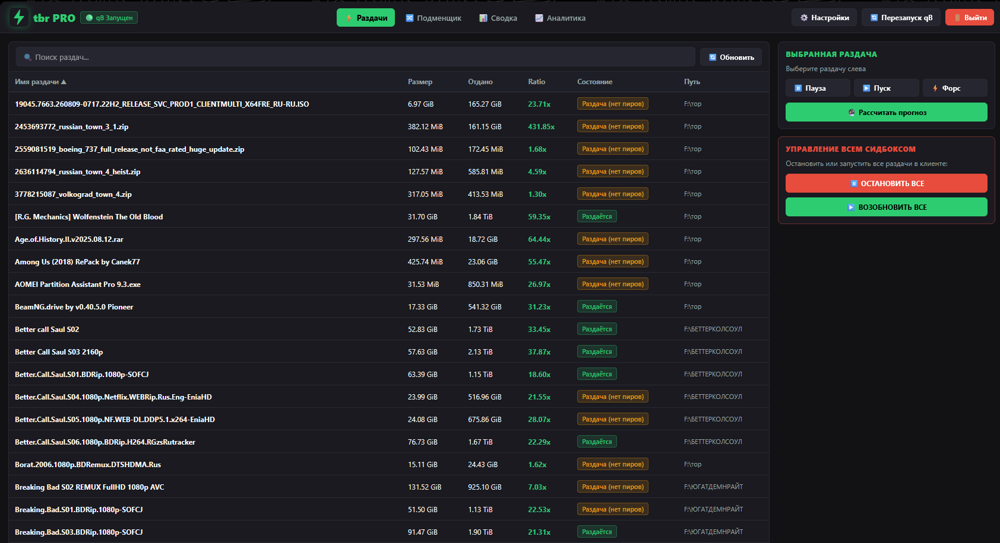
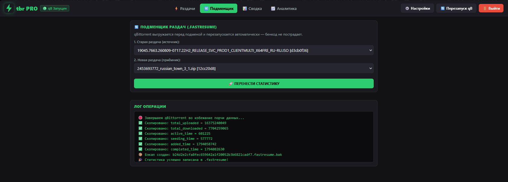
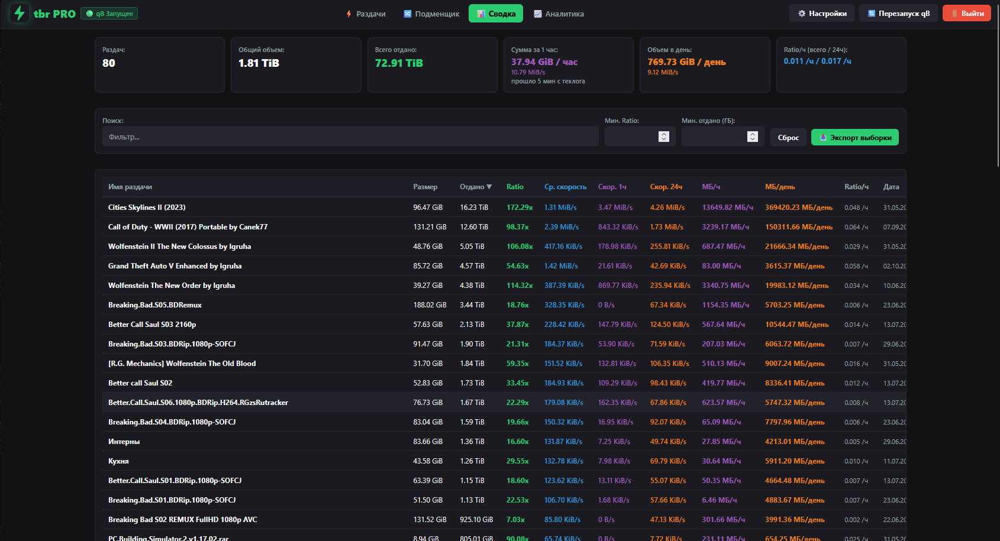
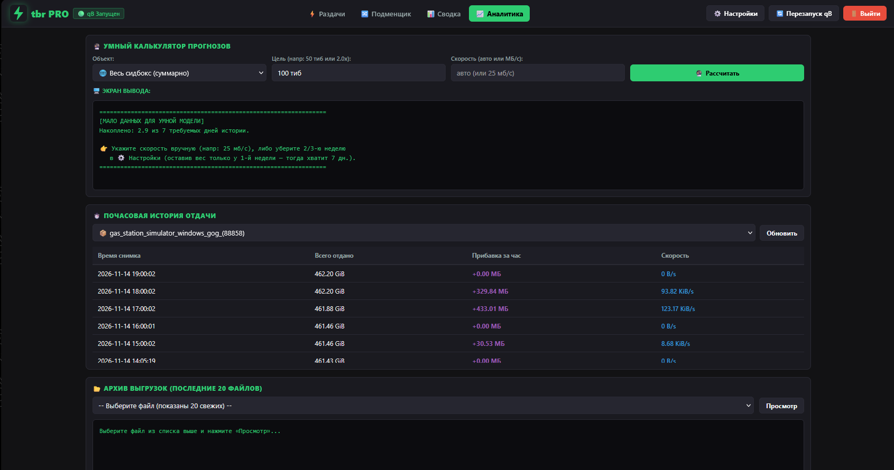

# tbr pro — qbittorrent swiss-army knife

> supports **en / ru** ui toggle right in the header!

# features

1. **pause and resume all torrents at once** (groundbreaking technology, i know)

2. **export csv summaries** so you can finally show your wife, mom, dad, or boyfriend why your pc hasn't been turned off in a month

3. **fastresume stats merger:** if you're a ratio-obsessed stats nerd and don't want to lose all upload stats on a torrent—or keep 50 versions of the same game on your pc—you can transfer `uploaded` & `seeding_time` metadata to a new torrent using my *innovative* merger (safely closes and restarts qbittorrent so bencode doesn't get corrupted)

4. **smart eta forecaster & hourly history:** calculate when you'll hit a specific upload/ratio goal using weighted historical data (sqlite), or check how a torrent gained its upload hour-by-hour

5. **works even without qbittorrent webui running** (well, except tab 1—obviously, it basically mirrors the webui)

6. **light as a feather** — tiny standalone `.exe`, no python required

7. **convenient (for me) file structure**

# screenshots

### 1. torrents

### 2. fastresume merger

### 3. summary

### 4. analytics & forecaster

# why should i download your vibecode?

1. i haven't seen any real alternatives

2. the features are actually useful

3. please

# what do i need to make it work?

1. **qbittorrent webui with no password** (or enable *"bypass authentication for clients on localhost"* in qb webui settings)

2. **qbittorrent** — haven't tested other clients (transmission doesn't count, it's kinda creepy). and if you don't use qb, why are you even here, normie?

3. **windows** — built and tested on win 11, no idea if it runs on anything else

4. **paranoid about random `.exe` files?** fair enough! check the source, install `pip install -r requirements.txt` and run `python main.py`, or compile it yourself with `build.bat`

# outro

fellow pirates and piratesses, enjoy! don't eat yellow snow. if anything breaks or sucks, open an [issue](https://github.com/kamushek0o/tbr/issues) or hit me up at `loh260330@gmail.com`
