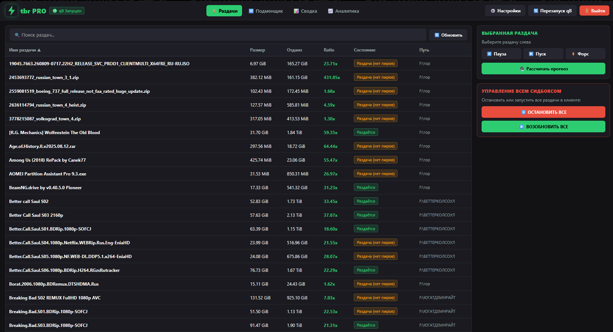
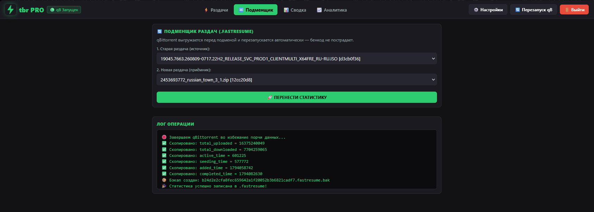
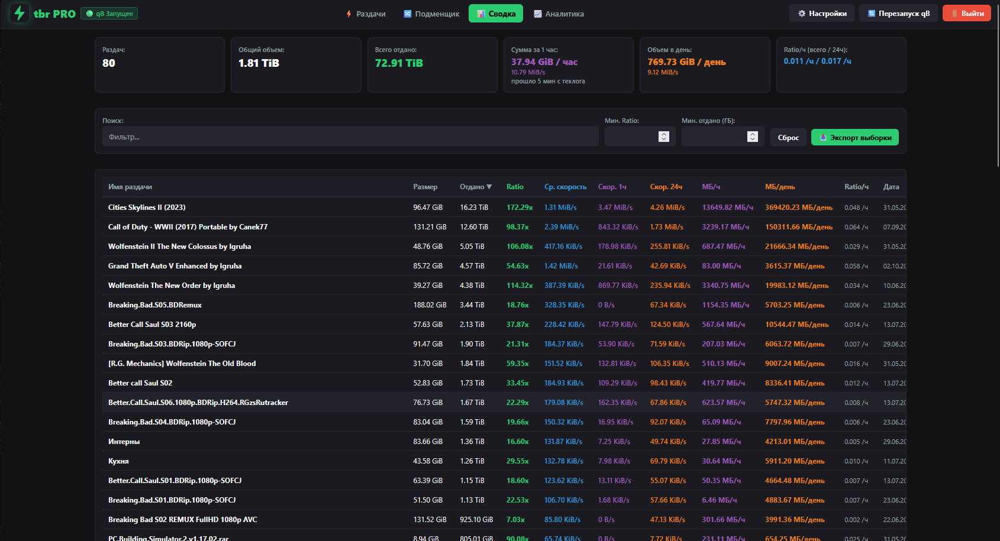
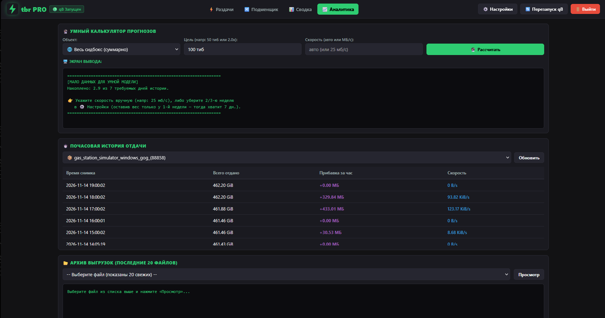

> [Read in English](README.md)

# ⚡ tbr PRO — швейцарский нож для qBittorrent

> Версия: **v3.0.1+** | Android-компаньон: **tbr-widget v1.3.0**  
> Встроенный переключатель языка **EN / RU** и тем оформления прямо в шапке!

# 🚀 Что умеет этот комбайн?

1. **Атомарный подменщик .fastresume с Torrent Diff и Smart Match:**
   Если вы любите красивую статистику и не хотите терять терабайты отдачи при перехешировании — переносите метаданные `uploaded` и `seeding_time` без битья bencode. Программа сама глушит и поднимает клиент, сверяет состав раздач пофайлово (% совпадения), находит пары через Smart Match (с защитой от римских/арабских сиквелов) и безопасно подчищает исходник с проверкой путей `content_path`. Планки целей (Goals) переносятся на лету!

2. **Честная аналитика, Like-for-Like (LFL) и 365-дневный Heatmap:**
   Никаких фантомных всплесков от добавления торрентов. Сравнение «Сегодня vs Вчера» и «Эта неделя vs Прошлая» считается строго секунда в секунду. Годовая тепловая карта активности в стиле GitHub, радар «Единственный сид», расчет индекса ценности раздачи (Health Score) и взвешенный калькулятор прогноза финиша на базе 4 SQLite-баз данных (WAL).

3. **Железная надёжность: Windows «Анти-сон», Watchdog и Детектор троттлинга:**
   Нативный перехватчик сна Windows через Win32 API (`SetThreadExecutionState`) держит систему бодрой, пока идет отдача выше порога. Сторожевой таймер Watchdog мягко перезапустит упавший qB (до 2 попыток с паузой 30с), Auto-Recheck повесит тег `io-error` при битом секторе диска, а анализатор графика сам распознает полку скорости и намекнет, что провайдер режет канал.

4. **Аварийный манифест (Disaster Recovery) и Panic Killswitch:**
   Красная кнопка на случай внезапного визита гостей или перегрузки: в один клик гасит всю отдачу, урезает глобальный лимит до 1 B/s, замораживает автопилот на 1 час и опционально убивает процесс клиента. А еженедельный экспорт манифеста упакует все раздачи, трекеры и magnet-ссылки в компактный JSON (хранятся 2 свежие копии).

5. **Сканер «сирот» на диске (Orphan Scanner):**
   Находит забытые гигабайты и папки в каталогах загрузок, которые давно удалены из клиента, но продолжают жрать место на SSD/HDD. Полная защита от Path Traversal, удаление строго вручную с двойным подтверждением.

6. **Умные таймеры: Smart Freeze, Snooze и Expiration:**
   - **Умная заморозка:** ставит на паузу только активные раздачи, запоминает их и возвращает в строй, не трогая старые паузы.
   - **Таймер сна (Snooze):** автономный таймер в базе (на 30м / 1ч / 2ч или вручную) с ограничением скорости или паузой.
   - **Срок жизни (Expiration):** самоуничтожение торрента по таймеру или достижению объёма отдачи (удаление файлов с диска по умолчанию выключено во избежание слёз).

7. **Параноидальная безопасность и Private Vault:**
   Раздельные пароли (`pbkdf2:sha256`) и API-токены (`tbr_api_...`), одноразовые ссылки-инвайты (`/invite/<token>`), защита от брутфорса и строгий RBAC (Admin / Viewer). Фирменный **Private Vault** на уровне бэкенда скрывает интимные теги от гостей (роли Viewer): раздачи либо полностью вырезаются из списков, либо обезличенно суммируются в общую статистику без утечки названий.

8. **Умные боты и «Тихий час» (Telegram & Discord):**
   Гибкие правила автопилота (+теги, -теги, пауза по ratio, дням или средней скорости в окне W). Режим DND («Тихий час») копит ночные уведомления в очередь и выкатывает аккуратный утренний дайджест, пропуская только критические тревоги. Регулярные дайджесты сами сравнят отдачу с прошлым периодом и дошлют отчет после простоя ПК.

9. **Android-виджет (`tbr-widget v1.3.0`) + PWA + Палитра команд (Ctrl+K):**
   Нативный виджет для рабочего стола Android на чистом Canvas (RGB_565, не жрёт память и батарею). Мгновенное переключение графиков в один тап (Скорость / Дни / Топ-N / Все сразу), оффлайн-кэш, автообновление APK прямо из GitHub Releases и быстрый вход по QR-коду. Веб-интерфейс работает как полноценное PWA-приложение, а по нажатию `Ctrl+K` доступна палитра команд в стиле VS Code.

10. **Зал славы сидера и локальный Share Card:**
    10 бессрочных достижений («Бог Ratio», «Главный хирург», «Ночная смена»), юмористические эквиваленты вашей отдачи (в современных играх, 4K фильмах и ISO-образах) и генератор красивой карточки статистики (Share Card PNG) на HTML5 Canvas с возможностью замазать названия раздач для безопасного хвастовства в чатах.

---

# 📸 Скриншоты

### 1. Раздачи и инспектор пиров


### 2. Подменщик .fastresume с Torrent Diff


### 3. Сводка и кастомизация таблицы


### 4. Графики, тепловая карта и аналитика


---

# 🛠️ Что под капотом?

- **Бэкенд:** Python 3, многопоточный сервер **Waitress** (threads=8) с мягким фоллбэком на Werkzeug, модульная архитектура на Blueprint'ах (все файлы строго до 300 строк).
- **Базы данных:** 4 независимые SQLite базы данных в режиме **WAL** с `busy_timeout=30000` (история отдачи, профили и инвайты, автопилот, состояние системы).
- **Надёжность:** горячий бэкап всех БД через `sqlite3.backup()` в `.zip` (с опциями скрытия секретов) и отложенное накатывание до старта движка.
- **Мобильный компаньон:** Kotlin, Android SDK 26–35, WorkManager, Jetpack Security Crypto, ZXing QR Scanner.

---

# 💻 Как запустить?

### Вариант 1: Готовый `.exe` (Windows)
1. Скачайте свежий `tbr.exe` из [Releases](https://github.com/kamushek0o/tbr/releases).
2. Запустите. В трее появится значок с молнией, а в браузере откроется панель управления.
3. Обновления прилетают по воздуху: программа сама проверит SHA-256, скачает патч и перезапустится через батник.

### Вариант 2: Headless-сервер / Docker (Linux / TrueNAS / Unraid)
```bash
docker build -t tbr-pro .
docker run -d \
  --name tbr-pro \
  -p 5000:5000 \
  -v /path/to/data:/data \
  -v /path/to/qBittorrent/BT_backup:/bt_backup \
  -e TBR_WEB_PASSWORD=your_super_password \
  tbr-pro
```
*Или напрямую через консоль:* `python main.py --headless --host 0.0.0.0 --port 5000`

### Вариант 3: Сборка из исходников
```bash
git clone https://github.com/kamushek0o/tbr.git
cd tbr
pip install -r requirements.txt
python main.py
```
*(Для самостоятельной компиляции в `.exe` запустите `build.bat`)*

### 📱 Виджет на Android
Забирайте готовый `.apk` из соседнего репозитория [tbr-widget Releases](https://github.com/kamushek0o/tbr-widget/releases). Откройте в веб-морде `⚙️ Настройки` -> `📱 QR-код`, наведите камеру телефона, и виджет подхватит хост и Viewer-токен без ручной возни.

---

# 🤝 Обратная связь

Братья пираты и сидбоксеры, пользуйтесь на здоровье, берегите диски и не кушайте жёлтый снег. Если нашли баг или есть идея для новой киллер-фичи — открывайте [Issue](https://github.com/kamushek0o/tbr/issues) или пишите на почту `loh260330@gmail.com`.


